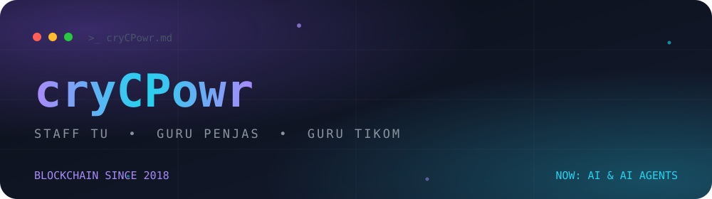

<!--
  🏫 cryCPowr — GitHub Profile README
  Satu orang, banyak peran: TU / Guru Penjas / Guru TIKOM / Blockchain Enthusiast / AI Learner
  🔧 Setup ular kontribusi (snake): file .github/workflows/snake.yml sudah disediakan.
     Tinggal push semua file ini ke repo, GitHub Actions akan otomatis membuat
     branch "output" berisi snake.svg — tidak perlu konfigurasi tambahan.
-->

<p align="center">
  
</p>

<p align="center">
  
</p>

<div align="center">
  
  
  
  
  
</div>

---

## 🎮 Status Pemain

```
┌──────────────────────────────────────────────┐
│  🎮 STATUS — cryCPowr                        │
├──────────────────────────────────────────────┤
│  Class   : Staff TU → Guru → Explorer        │
│  HP      : 100% (cadangan kopi tersedia ☕)   │
│  Attack  : Peluit 📣 + Keyboard ⌨️            │
│  Defense : Arsip rapi + backup data 💾        │
│  Quest   : Ngajar di sekolah, eksplorasi      │
│            blockchain, taklukkan AI agents 🤖 │
└──────────────────────────────────────────────┘
```

---

## 🚀 Tentang Aku

Berawal dari **meja tata usaha** yang rapi (surat, arsip, berkas — semua beres), terus dipanggil ke **lapangan**, dan sekarang juga ngajar di **lab komputer**. Di luar sekolah, aku menjelajah **blockchain sejak 2018**, dan lagi asyik belajar **AI & AI agents**. Satu orang, banyak mode. 😎

**Skill bar — jujur & apa adanya:**

- 🗂️ Administrasi Sekolah (TU)

  <rect width="300" height="20" rx="4" fill="#161B22"/><rect width="285" height="20" rx="4" fill="#22C55E"/><text x="150" y="34" font-family="monospace" font-size="11" fill="#8B949E" text-anchor="middle">Administrasi 95%</text></svg>" alt="Administrasi 95%" width="300" />

- 🏀 Penjas & Kesehatan

  <rect width="300" height="20" rx="4" fill="#161B22"/><rect width="270" height="20" rx="4" fill="#3B82F6"/><text x="150" y="34" font-family="monospace" font-size="11" fill="#8B949E" text-anchor="middle">Penjas 90%</text></svg>" alt="Penjas 90%" width="300" />

- 💻 TIKOM

  <rect width="300" height="20" rx="4" fill="#161B22"/><rect width="255" height="20" rx="4" fill="#06B6D4"/><text x="150" y="34" font-family="monospace" font-size="11" fill="#8B949E" text-anchor="middle">TIKOM 85%</text></svg>" alt="TIKOM 85%" width="300" />

- ⛓️ Blockchain / Web3

  <rect width="300" height="20" rx="4" fill="#161B22"/><rect width="225" height="20" rx="4" fill="#F59E0B"/><text x="150" y="34" font-family="monospace" font-size="11" fill="#8B949E" text-anchor="middle">Blockchain 75%</text></svg>" alt="Blockchain 75%" width="300" />

- 🤖 AI & AI Agents *(masih naik level!)*

  <rect width="300" height="20" rx="4" fill="#161B22"/><rect width="75" height="20" rx="4" fill="#8B5CF6"/><text x="150" y="34" font-family="monospace" font-size="11" fill="#8B949E" text-anchor="middle">AI Agents 25%</text></svg>" alt="AI Agents 25%" width="300" />

---

## ⛓️ Blockchain Journey — Sejak 2018

- ⛏️ **2018** — pertama kali kenal blockchain & kripto. Langsung penasaran, langsung nyemplung.
- 🐂 **Bear & bull** — dua-duanya sudah dirasakan. Masih berdiri tegak. 💪
- 💎 **Diamond hands** — belajar, riset, eksperimen. Jual panik? Tidak kenal.
- 🔗 **Web3 & decentralized** — sampai sekarang masih eksplorasi, teknologinya terus hidup.

> TL;DR: DCA, HODL, belajar terus. Bull run cuma bonus. 🐂📈

---

## 🧑‍🏫 A Day in My Life

| Waktu | Mode |
|---|---|
| 06:30 | Bangun. Kopi. Cek berita kripto. ☕ |
| 07:00 | **Mode TU**: surat, arsip, berkas — beres semua |
| 09:00 | **Mode Penjas**: peluit, lapangan, semangat! 🏀 |
| 12:00 | Istirahat. Cek chart. (Jangan tanya hasilnya 😅) |
| 13:00 | **Mode TIKOM**: lab komputer, murid-murid siap online 💻 |
| 15:00 | Pulang & recharge ⚡ |
| 20:00 | **Mode Learner**: AI, agents, dan eksperimen 🤖 |
| 23:30 | HODL. Tidur. Ulangi. 🔁 |

---

## 🛠️ Tools & Teknologi


> Dipakai untuk kerjaan sekolah & eksperimen digital. Masih nambah terus seiring belajar AI agents. 🚀

---

## 📈 Statistik GitHub

<p align="center">
  
</p>

<p align="center">
  
  
</p>

---

## 🐍 Kontribusiku (dimakan ular)

<picture>
  <source media="(prefers-color-scheme: dark)" srcset="https://github.com/cryCPowr/cryCPowr/blob/output/github-contribution-grid-snake-dark.svg" />
  <source media="(prefers-color-scheme: light)" srcset="https://github.com/cryCPowr/cryCPowr/blob/output/github-contribution-grid-snake.svg" />
  
</picture>

> 🐍 Ular ini makan kontribusimu. Kalau belum muncul, tinggal push — GitHub Actions otomatis bikinnya.

---

## 💬 Fakta Seru

- 😅 Bisa ganti mode **TU → lapangan → lab komputer** dalam hitungan menit.
- 🏃 Pernah dikejar deadline berkas sambil nyiapin pelajaran olahraga. Multitasking level dewa.
- ⛓️ HODL sejak 2018 — sarafnya sudah jadi baja.
- 🤖 Sekarang malah ngobrol sama AI agents buat bantu kerjaan sehari-hari.

---

<p align="center">
  
  
</p>

<p align="center">
  Dibuat dengan ❤️ + ☕ + 🤖 (iya, AI agent ikut bantu)
</p>

<p align="center">
  ⭐ Star repo ini kalau kamu suka · 🤝 Open untuk kolaborasi
</p>
